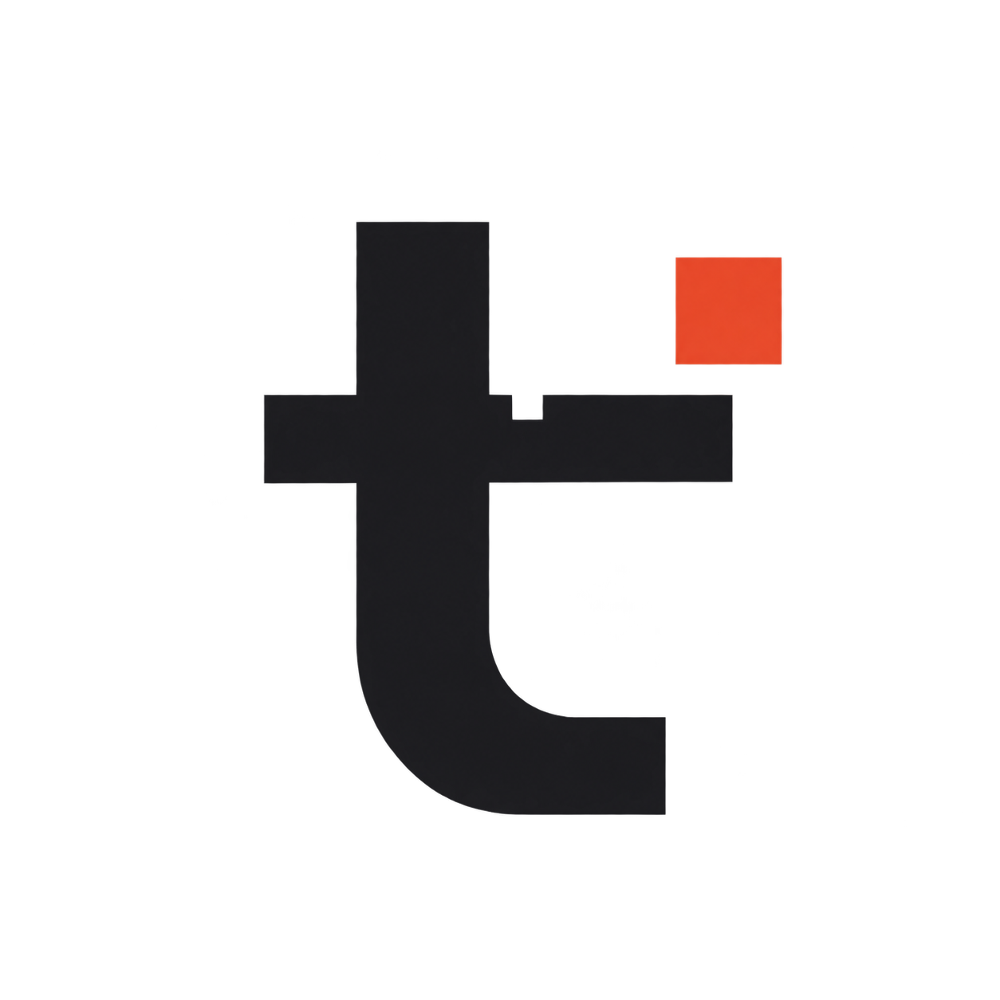
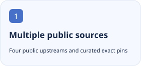
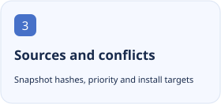

<p align="center"></p>

<h1 align="center">Tangyixiao DSH Plugin Market</h1>

<p align="center">Aggregate public DSH plugin indexes with maintained exact pins, an independent preview channel and auditable sources and conflicts.</p>

<p align="center"><a href="README.md">简体中文</a> · <a href="README.en.md">English</a></p>

[](https://github.com/tangyixiao/dsh-plugin-market/stargazers) [](https://github.com/tangyixiao/dsh-plugin-market/actions/workflows/publish.yml) [](LICENSE)

<p align="center">
  <picture><source media="(prefers-color-scheme: dark)" srcset="docs/assets/feature-1-en-dark.svg"></picture>
  <picture><source media="(prefers-color-scheme: dark)" srcset="docs/assets/feature-2-en-dark.svg"></picture>
  <picture><source media="(prefers-color-scheme: dark)" srcset="docs/assets/feature-3-en-dark.svg"></picture>
</p>

## Get started

```text
https://tangyixiao.github.io/dsh-plugin-market/index.json
```

[Preview index](https://tangyixiao.github.io/dsh-plugin-market/preview/index.json) · [Live market](https://tangyixiao.github.io/dsh-plugin-market/)

Add the stable index below through DSH Plugins → Discover → Add index source. Add /preview/index.json separately for previews and inspect exact versions, sources and compatibility before installing.

## Status and compatibility

| Item | Current source of truth |
| --- | --- |
| Source version | `0.1.0` · 以 [package.json](package.json) 为准 |
| Distribution | `index` · [Releases](https://github.com/tangyixiao/dsh-plugin-market/releases) |
| Node.js | `>=24` |
| Development | [Open issues](https://github.com/tangyixiao/dsh-plugin-market/issues?q=is%3Aissue+is%3Aopen) · [CI](https://github.com/tangyixiao/dsh-plugin-market/actions) |

Index and provenance validation is not installation or sandbox testing of every plugin. Aggregation does not replace original plugin licenses or source-specific content terms.

[详细指南](docs/guide.zh-CN.md)

## Development and participation

```sh
npm ci --ignore-scripts
npm test
npm run build
node tools/check-repository.mjs
```

[Contributing](CONTRIBUTING.md) · [Support](SUPPORT.md) · [Questions](https://github.com/tangyixiao/dsh-plugin-market/discussions) · [Report a bug](https://github.com/tangyixiao/dsh-plugin-market/issues/new/choose) · [Security](SECURITY.md) · [Maintenance](docs/maintenance.md)

## Star History

<picture><source media="(prefers-color-scheme: dark)" srcset="https://api.star-history.com/chart?repos=tangyixiao/dsh-plugin-market&amp;type=date&amp;theme=dark&amp;legend=top-left"></picture>

[Interactive chart](https://www.star-history.com/?repos=tangyixiao%2Fdsh-plugin-market&type=date) · [GitHub Stars](https://github.com/tangyixiao/dsh-plugin-market/stargazers)

The external chart uses real star records and may be cached or unavailable; no development percentage is inferred.

## Origin and licenses

[Software license](LICENSE) · [Logo artwork and attribution](public/assets/NOTICE.md)

Software retains its existing license. Whale-girl derivative artwork is separately CC BY-NC-SA 4.0 with the attribution chain for 上善, ZipZipPipe and Small-tailqwq.
