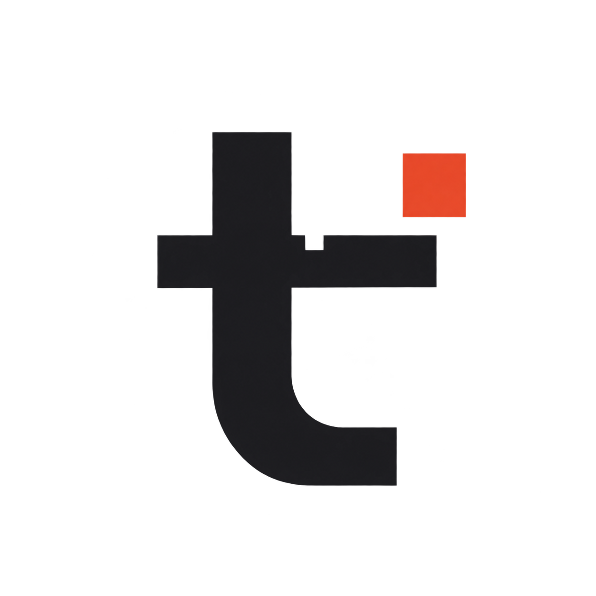
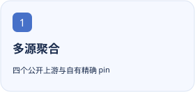
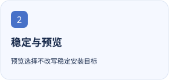
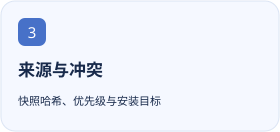

<p align="center"></p>

<h1 align="center">Tangyixiao DSH Plugin Market</h1>

<p align="center">聚合公开 DSH 插件索引，保留自有精确版本、独立预览渠道及可追溯的来源与冲突。</p>

<p align="center"><a href="README.md">简体中文</a> · <a href="README.en.md">English</a></p>

[](https://github.com/tangyixiao/dsh-plugin-market/stargazers) [](https://github.com/tangyixiao/dsh-plugin-market/actions/workflows/publish.yml) [](LICENSE)

<p align="center">
  <picture><source media="(prefers-color-scheme: dark)" srcset="docs/assets/feature-1-zh-CN-dark.svg"></picture>
  <picture><source media="(prefers-color-scheme: dark)" srcset="docs/assets/feature-2-zh-CN-dark.svg"></picture>
  <picture><source media="(prefers-color-scheme: dark)" srcset="docs/assets/feature-3-zh-CN-dark.svg"></picture>
</p>

## 开始使用

```text
https://tangyixiao.github.io/dsh-plugin-market/index.json
```

[预览索引](https://tangyixiao.github.io/dsh-plugin-market/preview/index.json) · [在线市场](https://tangyixiao.github.io/dsh-plugin-market/)

在 DSH「插件 → 发现 → 添加索引源」中添加下方稳定索引。需要预览时另加 `/preview/index.json`，安装前核对精确版本、来源和兼容范围。

## 当前状态与兼容性

| 项目 | 当前依据 |
| --- | --- |
| 源码版本 | `0.1.0` · 以 [package.json](package.json) 为准 |
| 分发方式 | `index` · [Releases](https://github.com/tangyixiao/dsh-plugin-market/releases) |
| Node.js | `>=24` |
| 开发状态 | [Open issues](https://github.com/tangyixiao/dsh-plugin-market/issues?q=is%3Aissue+is%3Aopen) · [CI](https://github.com/tangyixiao/dsh-plugin-market/actions) |

索引格式与来源核验不等于逐个安装或沙箱测试。聚合不改变原插件许可；Hub 原创翻译与验证内容须保留其来源与适用条款。

[详细使用、配置与故障排查](docs/guide.zh-CN.md)

## 开发与参与

```sh
npm ci --ignore-scripts
npm test
npm run build
node tools/check-repository.mjs
```

[Contributing](CONTRIBUTING.md) · [Support](SUPPORT.md) · [Questions](https://github.com/tangyixiao/dsh-plugin-market/discussions) · [Report a bug](https://github.com/tangyixiao/dsh-plugin-market/issues/new/choose) · [Security](SECURITY.md) · [Maintenance](docs/maintenance.md)

## Star History

<picture><source media="(prefers-color-scheme: dark)" srcset="https://api.star-history.com/chart?repos=tangyixiao/dsh-plugin-market&amp;type=date&amp;theme=dark&amp;legend=top-left"></picture>

[Interactive chart](https://www.star-history.com/?repos=tangyixiao%2Fdsh-plugin-market&type=date) · [GitHub Stars](https://github.com/tangyixiao/dsh-plugin-market/stargazers)

图表由外部服务按真实星标数据生成，可能缓存或暂时不可用；未填造开发百分比。

## 来源与许可

[Software license](LICENSE) · [Logo artwork and attribution](public/assets/NOTICE.md)

软件保持原许可证；鲸鱼娘衍生美术单独采用 CC BY-NC-SA 4.0，并保留上善、ZipZipPipe、Small-tailqwq 的署名链。
